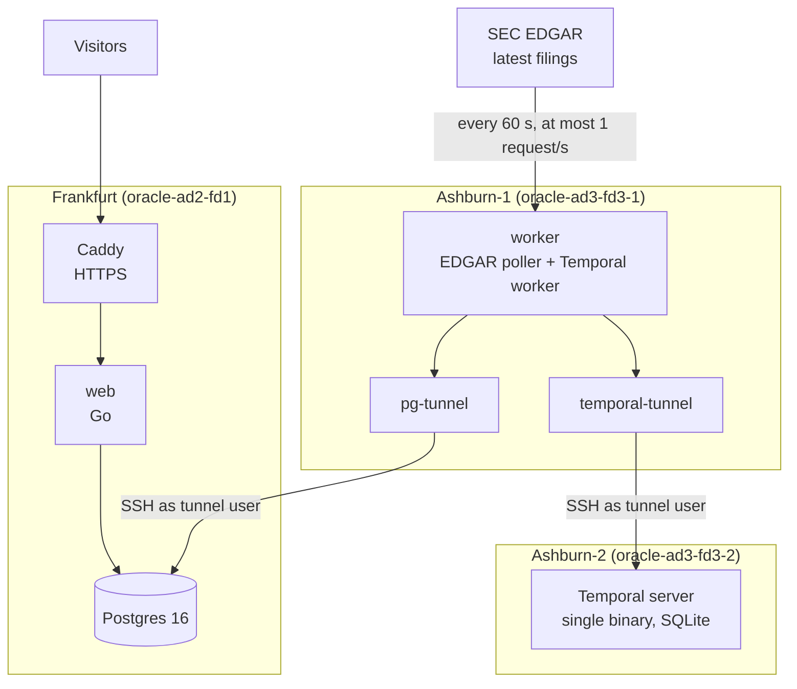

# Filing radar

Every new SEC filing, read by AI agents within minutes, explained with sources,
and checked against how the stock actually moved the next day.

**Status: stage 2, triage.** Every minute the worker reads EDGAR's latest
filings and stores each one once. Plain rules label every filing high, medium,
low or routine from its form and 8-K item numbers; a language model
(DeepSeek by default, Claude as an option) then reads each 8-K and scores it,
with a quote that must appear in the filing. The feed
opens on the important ones. All three servers are deployed by one pipeline,
and a status page shows the live health of every part.

## Architecture



| Server | Runs | Open to the internet |
|---|---|---|
| Frankfurt | Postgres, web, Caddy | 80, 443 (Caddy) |
| Ashburn-1 | worker (EDGAR poller, Temporal worker), two SSH tunnels | nothing |
| Ashburn-2 | Temporal server | nothing |

**Why this shape:**
- **Every server has 1 GB of RAM.** Each Go binary uses tens of MB, Temporal's single-binary server about 60 MB. Kubernetes or Argo CD would not fit.
- **No database port is public.** The worker reaches Postgres and Temporal through SSH tunnels. The `tunnel` user on each server has no shell and may forward to exactly one local port.
- **The worker proves the whole chain every minute.** It runs a tiny Temporal workflow end to end and writes the result to Postgres; the status page reads it.
- **Each filing is stored exactly once.** The accession number is the primary key and every insert is `ON CONFLICT DO NOTHING`, so retries and overlapping polls are harmless.
- **No gaps.** A poll pages back until it reaches filings already stored (at most 5 pages), and stores only after paging stops: a Form 4's entries can straddle two pages, and storing page by page would stop too early.
- **One Temporal workflow per tracked filing.** The workflow ID is the accession number, so Temporal refuses a second one while it runs. A dispatcher runs after every poll and starts a workflow for any filing without a label, so a crash or a Temporal outage heals by itself. Form 4s and other routine forms are labelled on the spot and never start one.
- **Rules first, model second.** Rules are free and explainable, and they label everything. The model reads only 8-Ks, under a daily cap, and can raise a label but never lower it. Every score carries a quote that's checked against the filing; a quote that isn't there means the score is dropped.
- **The model is swappable.** The workflow talks to one small interface (score, reason, quote); DeepSeek and Claude are two implementations sharing the prompt and the checks. Filings are public data, so the choice is about cost and quality.

## Deploying

The `deploy` workflow runs by hand (Actions → deploy → Run workflow):
1. Test, then build two images and push them to GHCR.
2. Deploy Temporal, then Frankfurt, then the worker, each over SSH as the `deploy` user.
3. Wait until the worker has reported through both tunnels, then until the ingestor has read EDGAR.

Its settings live in the `production` environment (Settings → Environments),
which only accepts deploys from `main`:

| Kind | Name | What it is |
|---|---|---|
| Secret | `DEPLOY_SSH_KEY_B64` | SSH key for the `deploy` user on all three servers |
| Secret | `TUNNEL_SSH_KEY_B64` | SSH key for the `tunnel` user, used by the worker's tunnels |
| Secret | `KNOWN_HOSTS_B64` | the three servers' host keys, so SSH can't be pointed at an impostor |
| Secret | `POSTGRES_PASSWORD` | database password |
| Secret | `EDGAR_USER_AGENT` | `Filing Radar <your email>`: SEC refuses requests without a contact |
| Secret | `DEEPSEEK_API_KEY` | optional: the model that scores 8-Ks (default model `deepseek-chat`) |
| Secret | `ANTHROPIC_API_KEY` | optional: Claude instead (default model `claude-opus-5-5`); with no key at all the rules label everything on their own |
| Variable | `TRIAGE_PROVIDER` | optional: `deepseek` or `anthropic`; empty means whichever key is set, DeepSeek first |
| Variable | `TRIAGE_MODEL` | optional: overrides the provider's default model |
| Variable | `TRIAGE_MODEL_DAILY_CAP` | optional, default 200 model calls per UTC day |
| Variable | `SITE_DOMAIN` | the site's name; Caddy gets its certificate |
| Variable | `FRANKFURT_HOST`, `WORKER_HOST`, `TEMPORAL_HOST` | server IPs |

To move to a real domain, point its A record at the Frankfurt IP, change
`SITE_DOMAIN`, and deploy again.

## Running locally

```bash
export EDGAR_USER_AGENT="Filing Radar you@example.com"
docker compose -f deploy/local/compose.yml up --build
```

Then open http://localhost:8088. The Temporal UI is at http://localhost:8233.

Tests: `go test ./...`. The store tests also run against Postgres when
`TEST_DATABASE_URL` is set (see `internal/store/filings_test.go`).

## API

| Endpoint | Returns |
|---|---|
| `GET /api/filings?form=8-K&level=medium&limit=50&before=<cursor>` | filings newest first, each with its `triage` label (null while pending); `level` means that level and above; `next` is the cursor for the following page |
| `GET /api/status` | the health of every part, as the status page shows it |
| `GET /healthz` | `ok` when the web server can reach Postgres |

## Roadmap

1. **Live filing feed, no AI.** ✅ The worker polls EDGAR's latest-filings feed every minute, stores each filing once (keyed by its accession number), and the website shows the feed.
2. **Triage.** ✅ Plain rules read each 8-K's item numbers and label every filing; a language model scores each 8-K with a checked quote and can raise the label.
3. **Analyst agent.** For material filings: what changed since the last filing, with a citation for every claim, and every citation checked against the filing's text.
4. **Evals.** A Temporal workflow per filing sleeps until the next market close, fetches the price, and scores the prediction. Scores are public.
5. **Live architecture page** with throughput, queue depth, agent time and cost.

## Layout

```
cmd/web          website and API (Frankfurt)
cmd/worker       EDGAR poller, Temporal worker and health reports (Ashburn-1)
internal/edgar   EDGAR client and feed parser
internal/ingest  one poll: page until overlap, then store
internal/triage  plain rules that label each filing
internal/pipeline the per-filing Temporal workflow and its dispatcher
internal/model   the model call (DeepSeek or Claude) that scores an 8-K, and the quote check
internal/store   Postgres access and schema
internal/status  turns health reports into what the status page shows
internal/ping    the one-minute Temporal round trip
deploy/          one folder per server, plus the tunnel image and local setup
```
