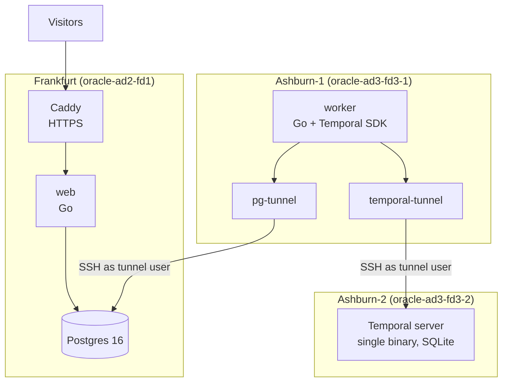

# Filing radar

Every new SEC filing, read by AI agents within minutes, explained with sources,
and checked against how the stock actually moved the next day.

**Status: stage 0, the walking skeleton.** All three servers are wired together
and deployed by one pipeline. The website shows the live health of every part.
The filing feed is stage 1.

## Architecture



| Server | Runs | Open to the internet |
|---|---|---|
| Frankfurt | Postgres, web, Caddy | 80, 443 (Caddy) |
| Ashburn-1 | worker, two SSH tunnels | nothing |
| Ashburn-2 | Temporal server | nothing |

**Why this shape:**
- **Every server has 1 GB of RAM.** Each Go binary uses tens of MB, Temporal's single-binary server about 60 MB. Kubernetes or Argo CD would not fit.
- **No database port is public.** The worker reaches Postgres and Temporal through SSH tunnels. The `tunnel` user on each server has no shell and may forward to exactly one local port.
- **The worker proves the whole chain every minute.** It runs a tiny Temporal workflow end to end and writes the result to Postgres; the status page reads it.

## Deploying

The `deploy` workflow runs by hand (Actions → deploy → Run workflow):
1. Test, then build two images and push them to GHCR.
2. Deploy Temporal, then Frankfurt, then the worker, each over SSH as the `deploy` user.
3. Wait until the worker has reported through both tunnels.

Its settings live in the `production` environment (Settings → Environments),
which only accepts deploys from `main`:

| Kind | Name | What it is |
|---|---|---|
| Secret | `DEPLOY_SSH_KEY_B64` | SSH key for the `deploy` user on all three servers |
| Secret | `TUNNEL_SSH_KEY_B64` | SSH key for the `tunnel` user, used by the worker's tunnels |
| Secret | `KNOWN_HOSTS_B64` | the three servers' host keys, so SSH can't be pointed at an impostor |
| Secret | `POSTGRES_PASSWORD` | database password |
| Variable | `SITE_DOMAIN` | the site's name; Caddy gets its certificate |
| Variable | `FRANKFURT_HOST`, `WORKER_HOST`, `TEMPORAL_HOST` | server IPs |

To move to a real domain, point its A record at the Frankfurt IP, change
`SITE_DOMAIN`, and deploy again.

## Running locally

```bash
docker compose -f deploy/local/compose.yml up --build
```

Then open http://localhost:8088. The Temporal UI is at http://localhost:8233.

## Roadmap

1. **Live filing feed, no AI.** The worker polls EDGAR's latest-filings feed every minute, stores each filing once (keyed by its accession number), and the website streams the feed.
2. **Triage.** Read the numbered items of each 8-K with plain rules, then add a model that scores how material the filing is.
3. **Analyst agent.** For material filings: what changed since the last filing, with a citation for every claim, and every citation checked against the filing's text.
4. **Evals.** A Temporal workflow per filing sleeps until the next market close, fetches the price, and scores the prediction. Scores are public.
5. **Live architecture page** with throughput, queue depth, agent time and cost.

## Layout

```
cmd/web          website and API (Frankfurt)
cmd/worker       Temporal worker and health reports (Ashburn-1)
internal/store   Postgres access and schema
internal/status  turns health reports into what the status page shows
internal/ping    the one-minute Temporal round trip
deploy/          one folder per server, plus the tunnel image and local setup
```
